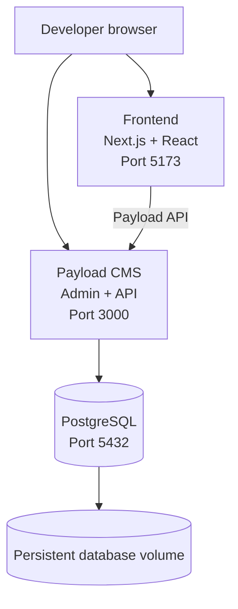

# AlphaProTrade

Market Intelligence for Traders

AlphaProTrade is a web platform with a separate customer-facing application and Payload CMS.

## Technology stack

| Technology | Version recorded in the project | Purpose |
|---|---:|---|
| Node.js | 24.22.3 | JavaScript runtime |
| pnpm | 10.23.0 | Package manager |
| React | 19.2.9 | User interface |
| Next.js | 16.4.6 | Web and CMS application framework |
| Payload CMS | 3.94.1 | CMS, Admin UI and APIs |
| PostgreSQL | 16.x | Database |
| TypeScript | 5.7.3 | Application development |
| Tailwind CSS | 4.3.5 | Styling |
| Vitest | 4.0.18 | Automated tests |
| Playwright | 1.63.0 | Browser tests |
| Docker / Docker Compose | Project-machine versions | Local container environment |

Versions are based on the project information available when this README was prepared. The package manifests and lock files in each application are authoritative.

## Architecture

The local Docker environment is intended to run three separate services:



| Service | Responsibility | Local URL |
|---|---|---|
| `web` | Customer-facing frontend | http://localhost:5173 |
| `cms` | Payload CMS Admin and API | http://localhost:3000/admin |
| `postgres` | Application database | Internal Docker network |

The frontend communicates with Payload CMS over the Docker network. Payload CMS connects to PostgreSQL using the database service name. The browser does not connect directly to PostgreSQL.

## Repository structure

```text
alphaprotrade/
├── README.md
├── docker-compose.yml
├── .env.example
└── apps/
    ├── cms/
    │   ├── Dockerfile
    │   ├── package.json
    │   └── src/
    └── web/
        ├── Dockerfile
        ├── package.json
        └── src/
```

The actual repository may contain additional source, configuration, test and documentation folders.

## Prerequisites

Install:

- Git
- Docker Desktop or Docker Engine
- Docker Compose v2

Node.js, pnpm and PostgreSQL should not need to be installed on the host when using the Docker-based development setup.

## Quick start

### 1. Clone the repository

```bash
git clone <repository-url>
cd alphaprotrade
```

### 2. Create the environment file

```bash
cp .env.example .env
```

Review `.env` and set the required local secrets and configuration values. Do not commit `.env`.

### 3. Build and start the application

```bash
docker compose up -d --build
```

This is the intended one-command startup for the three services: frontend, Payload CMS and PostgreSQL. The Compose configuration should wait for database health before starting dependent application initialization, and should run database migrations safely as part of startup.

### 4. Open AlphaProTrade

- Frontend: http://localhost:5173
- Payload CMS Admin: http://localhost:3000/admin
- Payload API: http://localhost:3000/api

The first administrator must be created using the project's secure bootstrap process. Administrator credentials and bootstrap secrets must be supplied locally and must never be committed to Git.

## Common Docker commands

Start services:

```bash
docker compose up -d
```

Build and start after Dockerfile or dependency changes:

```bash
docker compose up -d --build
```

View service status:

```bash
docker compose ps
```

Follow logs for all services:

```bash
docker compose logs -f
```

Follow logs for one service:

```bash
docker compose logs -f cms
docker compose logs -f web
docker compose logs -f postgres
```

Restart services:

```bash
docker compose restart
```

Stop services:

```bash
docker compose down
```

`docker compose down` stops and removes the containers and network but preserves the named database volume.

**Do not use `docker compose down -v` unless you intentionally want to delete the local database data.**

## Development and verification

Run application tests and checks inside the relevant application container, using the scripts defined in its `package.json`. For example, inspect available scripts with:

```bash
docker compose exec cms pnpm run
docker compose exec web pnpm run
```

Typical checks, when the corresponding scripts are present:

```bash
docker compose exec cms pnpm build
docker compose exec cms pnpm exec tsc --noEmit
docker compose exec web pnpm build
docker compose exec web pnpm typecheck
docker compose exec web pnpm test
```

## Environment and security

- Keep `.env` and all secret files out of Git.
- Use strong, unique local values for application secrets and database passwords.
- Do not place credentials in Dockerfiles or source code.
- Keep PostgreSQL on the internal Docker network unless there is a specific local development need to expose it.
- Use the project's migration process for schema changes. Do not use destructive database reset commands on a database containing data.
- The named PostgreSQL volume is intended to preserve data across container restarts and `docker compose down`.

## Troubleshooting

| Issue | What to check |
|---|---|
| A container exits during startup | Run `docker compose ps` and inspect `docker compose logs <service>`. |
| Frontend cannot reach the CMS | Check the CMS service name, internal API URL and Docker network configuration. Do not use `localhost` as the CMS hostname from inside the web container. |
| CMS cannot connect to PostgreSQL | Check the database service hostname, internal port `5432`, database name, username and password in `.env`. |
| Database is still starting | Check the PostgreSQL health check and CMS dependency condition. |
| A local port is already in use | Check which process owns ports `5173` or `3000` before stopping anything. |
| Schema or migration error | Inspect the migration status and logs. Do not delete the database volume or run destructive reset commands as a first fix. |

## Current implementation note

This README describes the intended three-container developer experience. The project snapshot supplied for preparing this document records a Compose setup that runs PostgreSQL only, with the CMS and frontend started as host processes. Therefore, the one-command workflow above is usable only after the root Compose file, both application Dockerfiles, environment template, container networking, health checks and startup migration process have been implemented and tested together.

Do not treat the three-container workflow as verified until a clean checkout has successfully completed:

```bash
cp .env.example .env
docker compose up -d --build
```

and the frontend, Payload Admin, API and database connectivity have all been checked.
